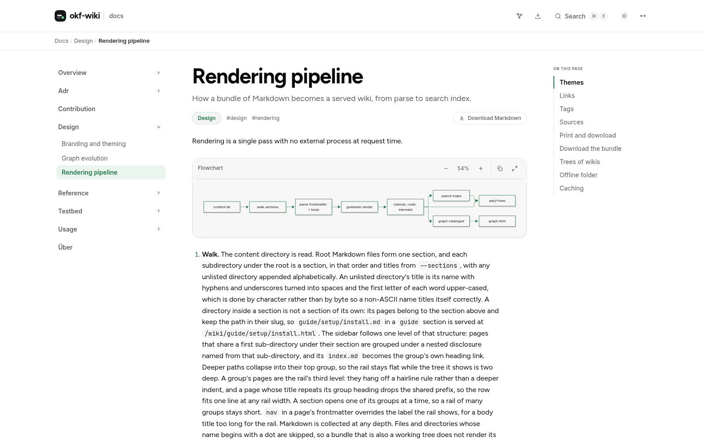
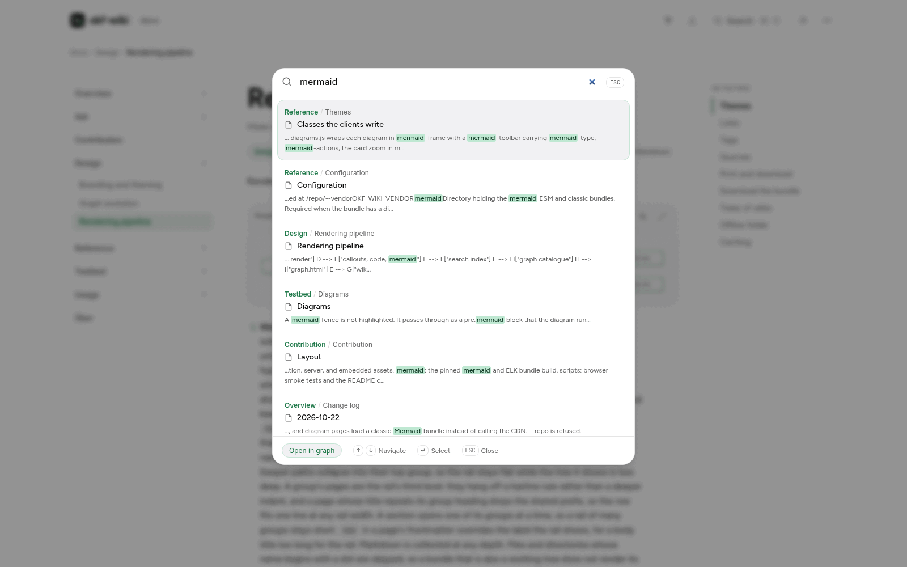
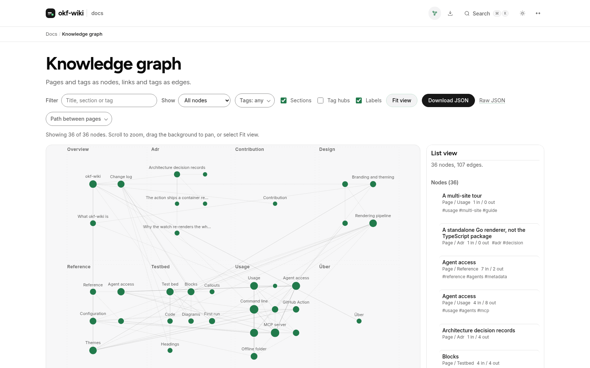
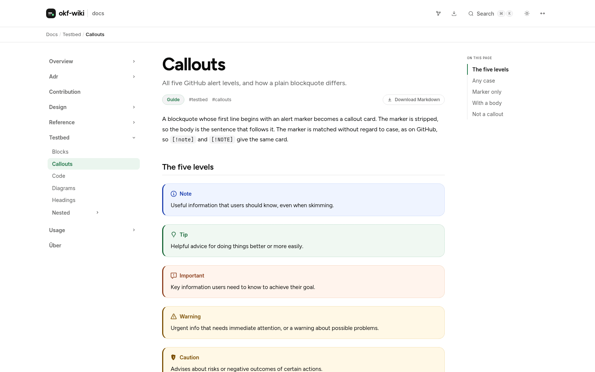
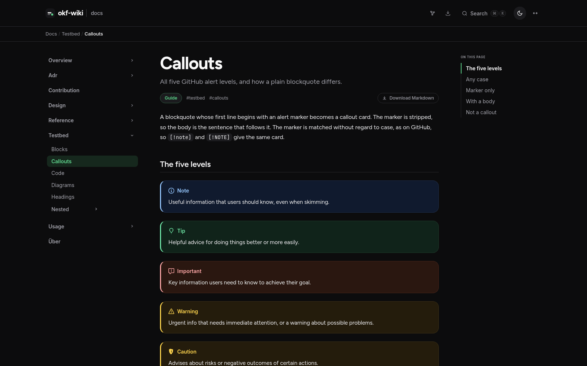
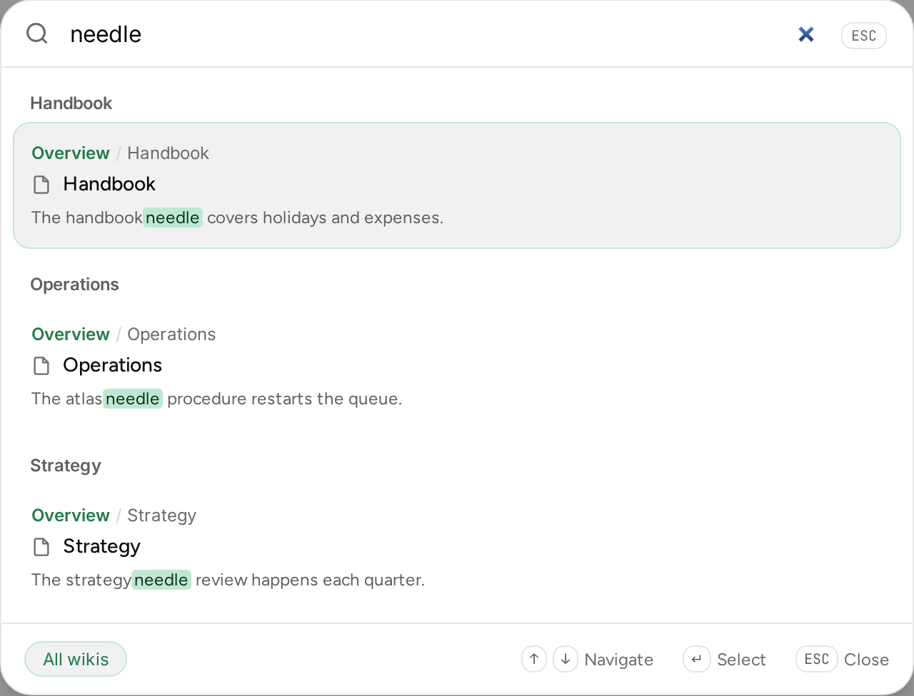

<p align="center">
  
</p>

<h1 align="center">okf-wiki</h1>

<p align="center">
  <strong>Your docs, rendered as a wiki.</strong><br>
  A static, searchable, themeable site from a folder of Markdown.<br>
  One binary or one container, with no build pipeline per project.
</p>

<p align="center">
  <a href="https://github.com/abn/okf-wiki/actions/workflows/ci.yml"></a>
  <a href="https://abn.github.io/okf-wiki/"></a>
  <a href="https://deepwiki.com/abn/okf-wiki"></a>
  <a href="go.mod"></a>
  <a href="LICENSE"></a>
  <a href="https://github.com/abn/okf-wiki/pkgs/container/okf-wiki"></a>
</p>

<p align="center">
  <a href="https://abn.github.io/okf-wiki/"><strong>Open the live wiki</strong></a>
  ·
  <a href="https://abn.github.io/okf-wiki/overview.html">Documentation</a>
  ·
  <a href="#quick-start">Quick start</a>
</p>



## What it is

okf-wiki is for teams that keep docs in Git and want them browsable,
searchable, and shareable without adopting a docs platform or a per-project
build pipeline. It reads an OKF v0.2 bundle, writes a static site, and serves
it. No editor, no database, no auth; the Markdown stays the source of truth.

## Highlights

- **Search without a service.** `Cmd/Ctrl-K` over a build-time index, grouped
  by section, or by wiki in a multi-site tree.
- **Diagrams without a network.** Mermaid with ELK layout, a pan/zoom
  lightbox, and a runtime bundled into the image.
- **A navigable graph.** Section clusters, semantic zoom, path finding, and
  search-to-graph.
- **Agent-ready.** `llms.txt`, `pages.json`, Markdown sources, and a read-only
  MCP server.
- **Themes at runtime.** Light and dark, re-skinned by mounting a directory,
  with no rebuild.
- **Deploy where you already are.** One static binary, one container, a GitHub
  Action, or an offline folder.

## Search

Full-text search runs over an index built at render time, so there is no
search service to run. Results are grouped by section, keyboard-first, and can
jump straight to the graph.



## Graph

The graph is built from the same bundle: pages and tags as nodes, links and
tags as edges. It supports section clusters, semantic zoom, path finding
between two pages, and search-to-graph.



## Themes

The default theme is embedded in the binary. `--theme DIR` (or
`OKF_WIKI_THEME`) layers a directory over it, so re-skinning is a bind mount
and an environment variable rather than a rebuild.

<p align="center">
  
  
</p>

```bash
podman run --rm -p 8080:8080 \
  -v "$PWD/docs:/content:ro" \
  -v "$PWD/themes/acme:/theme:ro" \
  -e OKF_WIKI_THEME=/theme \
  ghcr.io/abn/okf-wiki:latest
```

A theme restates only what it changes. Add `,Z` to both mounts on an SELinux
host. See [docs/reference/themes.md](docs/reference/themes.md).

## Multi-site trees

One tree can hold many wikis, with search across the whole tree and a header
that belongs to the deployment rather than the wiki you happen to be in.



See [the multi-site tour](docs/usage/multi-site-tour.md) for the index, the
breadcrumb, and the phone layout.

## Quick start

Container, with no Go toolchain and no build step:

```bash
git clone --depth 1 https://github.com/abn/okf-wiki.git
cd okf-wiki
podman run --rm -p 8080:8080 -v "$PWD/docs:/content:ro" ghcr.io/abn/okf-wiki:latest
# open http://127.0.0.1:8080/wiki/
```

The same command works with `docker`. On an SELinux host, append `,Z` to the
mount: `-v "$PWD/docs:/content:ro,Z"`. Replace `$PWD/docs` with any OKF bundle.

Prebuilt binaries, for linux, macOS and Windows on amd64 and arm64, are on the
[releases page](https://github.com/abn/okf-wiki/releases/latest):

```bash
curl -fsSLO https://github.com/abn/okf-wiki/releases/latest/download/okf-wiki_linux_amd64.tar.gz
tar -xzf okf-wiki_linux_amd64.tar.gz
cd okf-wiki_linux_amd64
./okf-wiki serve --content /path/to/bundle
# okf-wiki: serving .scratch/wiki at http://127.0.0.1:8080/wiki/
```

The archive carries the diagram runtime, so a bundle with diagrams needs no CDN
call. With Go 1.25 or newer, `go install github.com/abn/okf-wiki/cmd/okf-wiki@latest`
builds the same binary from source and puts it in `$(go env GOPATH)/bin`. Point
`--content` at any OKF bundle; `make run` does the same from a checkout and
opens the browser.

## Use from an agent

The wiki publishes `llms.txt`, `pages.json`, and the Markdown sources, and it
can serve a read-only MCP endpoint for search, page and section reads, budgeted
context packs, graph navigation, changes, and health:

```bash
okf-wiki serve --content ./docs --mcp
# endpoint: http://127.0.0.1:8080/wiki/_/mcp
```

The standalone `okf-wiki mcp` command reads a published wiki and can federate
several sources over stdio or HTTP:

```bash
okf-wiki mcp --source docs=https://docs.example.com/wiki/
```

See [docs/usage/mcp.md](docs/usage/mcp.md) for client configuration and
federation, [docs/usage/agent-access.md](docs/usage/agent-access.md) for the
discovery and citation surface, and
[docs/reference/agent-access.md](docs/reference/agent-access.md) for the result
contract.

## GitHub Actions

```yaml
- uses: abn/okf-wiki/action@main
  with:
    content: docs
    deploy: true    # omit to build only
```

The base path comes from the repository name, so a project site publishes under
`/<repo>` unconfigured. `@main` tracks the branch until a stable `v1` tag is
published. See [docs/usage/github-action.md](docs/usage/github-action.md).

## Documentation

- Live wiki: <https://abn.github.io/okf-wiki/>
- Source bundle: [`docs/`](docs/index.md), rendered by this tool
- DeepWiki: <https://deepwiki.com/abn/okf-wiki>
- Command line, container, offline folder, multi-site, graph, and MCP:
  [docs/usage/index.md](docs/usage/index.md)
- Every flag and environment variable:
  [docs/reference/configuration.md](docs/reference/configuration.md)

## Development

```bash
make check        # format, vet, test
make render       # render docs/ to .scratch/wiki
make vendor       # build the offline mermaid bundle (needs node)
make screenshots  # capture the README images (needs Playwright and Chrome)
make container/build
```

See [docs/contribution/index.md](docs/contribution/index.md) for the working
agreement.

## Licensing

MIT. See [LICENSE](LICENSE).

Third-party components ship with their own licenses, which are recorded in
[THIRD-PARTY.md](THIRD-PARTY.md): the self-hosted fonts under the SIL Open Font
License, and the bundled diagram runtime, which is mostly MIT. A theme may
bundle its own faces, and then that theme's license applies to them.
