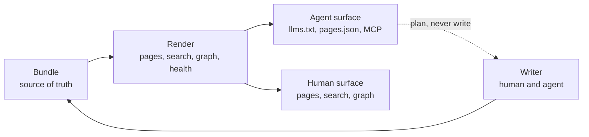

# Capability candidates

This is a working list, like [Graph evolution](graph-evolution.md), not a decided
design. It records what the LLM Wiki pattern and the projects built on it suggest
that okf-wiki should consider, what the evidence for each one is, and how small
the first version could be. Nothing here is committed to.

The pattern itself is assessed in the investigations wiki, under
`research/investigations/methods/llm-wiki/`. The finding that matters for this
project is narrow: the parts of that pattern with the best evidence are the
parts a renderer can do, and the parts a renderer cannot do have the weakest
evidence.

## The constraint

okf-wiki is a read-only reader. The bundle is the source of truth, a person and
an agent write it, and the render never invents a fact. Every candidate below
has to work from the bundle alone, at render or at read time, with no write
path, no model in the render, and the same output on every machine.

Five findings from that work survive the constraint.

1. Structural checks belong to code. Broken links, unresolved citations,
   duplicates and staleness are computable, and a model asked the same question
   passes a wiki whose fact has changed.
2. An agent needs a manifest before it reads. okf-wiki already writes one, and it
   is the cheapest place to answer "should I update a page or create one".
3. The compiled page is not the retrieval layer. The Markdown source has to stay
   reachable beside the HTML, which it already is.
4. A rule works when it arrives at the point of use, not when it sits on a page.
5. Extend, do not create. Near-duplicate pages are the default failure of every
   implementation that tried this.

## Candidates

Ordered by leverage against cost. The smallest version is what a first change
would ship, not the whole idea.

| # | Candidate | What it does | Smallest useful version | Evidence |
| :--- | :--- | :--- | :--- | :--- |
| 1 | Citation surface | Carries frontmatter `sources` and `verified`, and the validator's provenance findings, into the manifest an agent reads | Parse and publish at render; add `sources`, `verified` and the findings to `pages.json` | Three projects converged on deterministic citation checks; the OKF CLI has the checks, the render does not carry them |
| 2 | Wiki health | Page-level checks beside the graph health: unresolved citation, missing provenance on a typed entry, stale `staleAfter`, near-duplicate subjects, a page title repeated across sections | New checks in `health.json`, the MCP `health` tool and a `check` subcommand | The most repeated finding in the pattern's thread |
| 3 | Page planning | Ranks existing pages a draft should update, with the reason, and says whether it looks like a new subject | A deterministic lexical rank over `pages.json` and headings, as an MCP tool and a CLI verb | Routing decisions were most of the ingest cost; a classifier beat the model on them |
| 4 | Retrieval receipts | Reports what an answer was given: sections read, bytes against the budget, what was clipped, and which pages were cited | Extend the `context_for` result and log one line per call | Silent truncation is invisible to recall and to confidence |
| 5 | Rules at the point of use | Indexes typed rule pages and returns the rule text verbatim before the pages for a task | A `rules.json` beside `pages.json` and a `rules_for` tool | The largest measured effect in the thread: 0 of 8 to 8 of 8 |
| 6 | Human digest | A view of decisions, open questions with an owner, and what changed since a date | A server endpoint under `_/`, built from typed frontmatter | The counter-position: a wiki its owner cannot read after a break is agent memory, not a wiki |
| 7 | Semantic sidecar | Concepts and typed relations as a separate artifact with provenance | The items already listed under the semantic layer in [Graph evolution](graph-evolution.md) | Weakest evidence of the seven; the no-embedding results are as good as the embedding ones |

### 1. Citation surface

The manifest already carries a content hash per page. What it does not carry is
what the page is built on. OKF v0.2 has the fields for it: a page names its
sources in frontmatter, stamps `verified`, and cites them by footnote in the
body. The `okf` CLI already validates the footnote definitions and reports a
dangling marker, an unreferenced definition and an unmatched pair.

None of that reaches the render. `okf-wiki render` does not run the validator
and `pages.json` does not carry `sources` or `verified`, so an agent reading the
manifest cannot tell a cited page from an uncited one, and a bundle served
without a separate check can hold a page whose evidence does not resolve.

The work here is to consume, not to rebuild: run the checks a render can afford,
carry `sources`, `verified` and the finding list into the manifest, and let a
reader ask which claim rests on which source.

### 2. Wiki health

`health.json` covers the graph today: orphans, broken links, tag-only pages,
cycles and the most connected pages. The page-level checks the pattern's thread
kept asking for are a different pass, and they belong in the same artifact.

The `okf` CLI already computes several of them: broken links, footnote
definitions, `stale_after` validity, status vocabulary, and the trust fields. A
render should merge those findings into `health.json` rather than compute a
second opinion.

What neither the CLI nor the graph does is the part the thread cared about most:

- A page typed as a decision or an evaluation with no `sources` at all. The
  field is optional per page and required by the subject.
- A `verified` stamp older than the page's own content hash.
- Two pages in different subject directories whose titles and descriptions are
  close enough to be one subject.
- A page title that appears unlinked in several pages, which usually means a
  missing page rather than a missing link.

The duplicate check needs care. In a bundle that uses a subject directory with
`overview`, `report` and `evidence` as siblings, title similarity finds every
one of those pairs and nothing useful. The check has to compare across subject
directories and skip role siblings, which means the renderer needs a page's
subject and role, not just its title.

### 3. Page planning

This is the only ingest-shaped capability that fits a read-only renderer,
because it reads and never writes. Given a draft or a summary, return the
existing pages it would touch, ranked, with the shared tags, headings and links
that justify each one, and a verdict on whether it looks like a new subject.

Today an ingest agent does this by reading the index and hoping. The thread's
measurement says that is where most of the cost goes and where the model is
least reliable. A lexical rank over titles, descriptions, headings and tags is
deterministic, needs no model, and answers the one question that keeps
duplicates out.

### 4. Retrieval receipts

`context_for` already returns a token budget and a `truncated` flag. What it
does not return is the accounting: which sections were read, how many bytes of
each, what was dropped to fit, and which pages the caller later cited.

A line per call, written to a log the operator chooses, turns "the wiki had it
and the answer ignored it" from a suspicion into a query. It also makes the cost
of a context pack visible, which is the number an agent budget is actually
spent on.

### 5. Rules at the point of use

A bundle already holds the rules a project runs by: invariants in `AGENTS.md`,
`.agents/rules/`, and pages typed as guidance. An agent that reads them at the
start of a session and then works for forty minutes is the failure mode the
thread measured. The fix is to deliver the rule again when the work happens.

For a renderer, that means indexing rules as their own small artifact and
letting a client ask for the rules that cover a task, a path or a page type. The
text is returned verbatim, never summarised, because a summarised rule is a new
rule.

### 6. Human digest

The strongest counter-position in the thread is that the wiki is for the person
directing the agents, not for the agents. The test it proposes is blunt: if the
owner lost their memory of the project, could this page rebuild the current
state and name what needs a decision?

okf-wiki has the typed data for that already. A digest view of decisions, open
questions with an owner, drafts older than a set age and pages changed since a
date would answer it without adding a board or a lifecycle to the bundle. It is
the one candidate that is purely for the human reader, which is why it belongs
after the agent-facing ones but should not be dropped.

### 7. Semantic sidecar

This is already listed under [Graph evolution](graph-evolution.md), and nothing
in the pattern changes the order. If anything it argues for patience: the
implementation that removed embeddings matched them on its own benchmarks at a
fraction of the latency and memory, and the counter-evidence for semantic edges
is about multi-hop questions rather than about finding a page. The structural
catalogue and a lexical rank should be exhausted first.

## What not to build

- **A write path.** Authoring through the wiki duplicates the job of the editor
  and the commit, and it breaks the contract that the bundle is the only source
  of truth. A plan is useful; a write is not.
- **Chat.** The agent is already the chat. A second one inside the wiki would
  need a model, a session and a review path that the bundle does not have.
- **Embeddings at render.** A render has to be deterministic and reproducible
  from the bundle. A vector index built at render is neither, and its output
  cannot be checked by a reader.
- **A database.** The bundle is the database. The moment it needs a second store
  to be useful, the format has already failed.

## What the bundles look like today

A read-only probe over two bundles on 30 October 2026 set the order above. It
read frontmatter, footnotes and relative links and changed nothing.

| Measure | This docs bundle | A research bundle |
| :--- | ---: | ---: |
| Pages | 145 | 673 |
| Pages with `sources` | 1 | 455 |
| Pages with `verified` | 0 | 15 |
| Pages using footnotes | 1 | 435 |
| Footnote pages with no `sources` | 0 | 17 |
| Page pairs above 0.5 title similarity | 3 | 1,019 |

Three lessons.

First, provenance does not reach the manifest. One bundle uses the fields
everywhere and the other never does. The validator checks footnotes and links,
but not whether a `sources` registry matches the body, and the render carries
neither the fields nor the findings. That is why the citation surface comes
first: without it, the health checks have nothing to read.

Second, a naive duplicate check is worse than none. Almost all of the 1,019
pairs are `overview`, `report` and `evidence` siblings of the same subject. The
check needs the subject and role, which the graph already computes for sections.

Third, the render already walks everything these checks need. The parse, the
frontmatter, the links and the hash are all in memory during a render. These are
passes over data that exists, not a new pipeline.

## Suggested order

1. Citation surface, because every later check reads it.
2. Wiki health, on top of the citation data.
3. Page planning, which closes the ingest loop without a write path.
4. Retrieval receipts, small and independent.
5. Rules at the point of use, once the type vocabulary settles.
6. Human digest.
7. Semantic sidecar, last and opt-in.

## Open questions

- Is the digest a rendered page, a server endpoint under `_/`, or an MCP tool
  that an agent reads out loud? The first is the most useful and the most
  exposed to the bundle's own page rules.
- Does okf-wiki own page planning, or only publish the manifest that a separate
  ingest tool ranks? The boundary is the difference between a reader and a
  half-writer.
- Which health checks are policy and which are always on? A public docs bundle
  and a research bundle want different rules for `staleAfter` and `verified`.
