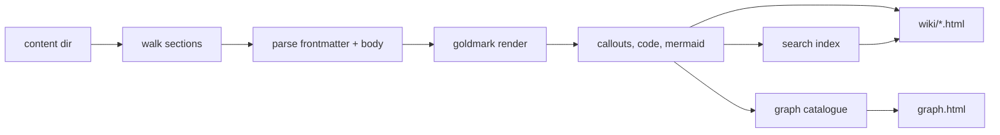

# Rendering pipeline

Rendering is a single pass with no external process at request time.



1. **Walk.** The content directory is read. Root Markdown files form one
   section, and each subdirectory under the root is a section, in that order and
   titles from `--sections`, with any unlisted directory appended
   alphabetically. An unlisted directory's title is its name with hyphens and
   underscores turned into spaces and the first letter of each word upper-cased,
   which is done by character rather than by byte so a non-ASCII name titles
   itself correctly. A directory inside a section is not a section of its own:
   its pages belong to the section above and keep the path in their slug, so
   `guide/setup/install.md` in a `guide` section is served at
   `/wiki/guide/setup/install.html`. The sidebar follows one level of that
   structure: pages that share a first sub-directory under their section are
   grouped under a nested disclosure named from that sub-directory, and its
   `index.md` becomes the group's own heading link. Deeper paths collapse into
   their top group, so the rail stays flat while the tree it shows is two deep.
   A group's pages are the rail's third level: they hang off a hairline rule
   rather than a deeper indent, and a page whose title repeats its group heading
   drops the shared prefix, so the row fits one line at any rail width. A
   section opens one of its groups at a time, so a rail of many groups stays
   short. `nav` in a page's frontmatter overrides the label the rail shows, for
   a body title too long for the rail.
   Markdown is collected at any depth. Files
   and directories whose name begins with a dot are skipped, so a bundle that is
   also a working tree does not render its own `.git`.
2. **Parse.** Each file is split into frontmatter and body. The body is parsed
   with goldmark (CommonMark plus tables, task lists, footnotes). Heading ids
   are assigned from the heading text and made unique within the page. An on-page
   table of contents collects level two only, though every heading still gets
   an id. Level-two headings grow a `#` permalink on hover.
3. **Transform.** Fenced code is highlighted with Chroma into `pre.code.chroma`,
   with a `language-*` class naming the language. A fence with no language is
   escaped into `pre.code` and left unhighlighted. GitHub alert blockquotes
   (`> [!NOTE]`) become callout cards. The marker is matched without regard to
   case, the way GitHub matches it, so `> [!note]` and `> [!NOTE]` are the same
   card; a marker that is not one of the five is left alone, and so is one that
   is not at the very start of the first line, such as a marker after a link.
   Mermaid fences pass through as `<pre class="mermaid">` for the browser to
   render.

   Every code and text block (`pre.code`, highlighted or not, and any other
   `pre` in the prose) carries a copy button in its top-right corner, added
   client-side by `diagrams.js`; it is hidden when printing.

   The browser draws each diagram into a card: a toolbar naming the type, a
   zoom group and the copy and expand affordances, then the drawing. Every
   type renders at one size, and a diagram opens fitted to the card, so its
   whole shape is visible; the zoom buttons step the scale and the card's
   scroll area takes over. Full screen repeats the drawing, fitted to the
   window, with the same zoom and a drag to pan, and closes on Escape or a
   click on the field around it. A diagram that will not parse becomes a red
   card carrying the parser's message and the source, so the mistake is
   readable where it is written rather than an empty block.

   The drawing is announced as one image, so a screen reader gets its name
   once instead of every node label in it. The name comes from the fence's
   own `accTitle` and `accDescr` when the author wrote them, and from the
   nearest preceding heading otherwise: a flowchart under a heading called
   Rendering pipeline is announced as "Flowchart: Rendering pipeline". The
   type word is the readable one rather than mermaid's internal name.

   Footnotes whose label matches a `sources[]` id are rewritten into numbered
   citations to a generated Sources section; see [Sources](#sources).
4. **Index.** Each page is split into heading-anchored text chunks, and the
   catalogue is written as two files that load at different speeds.
   `search-index.json` is a page table plus the entries that refer to it: an
   entry names its page by index and carries the heading, section and anchor,
   so a page's url and titles are stored once however many sections it has. The
   index also carries the render base and a render ID, so a federated MCP source
   mounted under a different URL path can resolve its citations without guessing.
   `search-content.json` carries the entry texts in entry order. The deep link
   is the page url plus the entry's anchor, an empty anchor being the page
   itself. The client expands the table into the flat entries it scores,
   reading the page fields through the table rather than copying them, and
   searches titles, documents and sections as soon as the light index arrives.
   A page row carries its graph node ID, so the modal can open the selected hit
   in the graph with the query filter still active.
   It fetches `search-content.json` in the background, attaches each text to
   its entry by position, and ignores the file whole if its count does not
   match the index. An open query is re-run when the texts arrive, so content
   matches join the results without a keystroke, while a failed text load
   leaves the light index answering. A chunk's text is capped at 12,000 bytes,
   cut at a word boundary where the prefix holds one and at a rune boundary
   otherwise, so one unusually long section cannot dominate the file. The
   client lowercases each entry's match fields once as
   it scans the index and debounces typing, so a burst of keystrokes triggers
   one search over prepared text rather than re-lowercasing the whole index on
   every keystroke; Enter, the arrows and Escape stay immediate.

   An entry matches when every term is present in one of its fields, and the
   score puts a title hit above a document, section or content hit. Beyond the
   field weights, a term that starts a word in a title or a document scores
   above one found mid-word, and a term the entry repeats in its text climbs a
   step at two, four and eight mentions. Equal scores break on global keys: an
   overview entry before a section entry, then the shorter title, then the
   entry's place in the index, so the order is the same in every browser. The
   matching set, the grouping and the caps do not move.

   Tags are collected into `tags.json`, a catalogue of display name, tag page
   URL and page count, which the modal fetches only for hash-prefixed queries.
   In a multi-site tree, each wiki keeps its own index and content file, and
   the tree also gets an aggregate pair at its base: the pages and entries of
   every wiki that rendered, with the wikis' page tables merged into one and
   every entry rebased onto it, and each page labelled with the wiki it came
   from, so a search from any wiki reaches all of them. A wiki that was skipped
   contributes nothing to the aggregate. A content root that is itself a wiki
   is a tree of one, whose index already sits at the base; it gets no separate
   aggregate, so its search reads as one bundle's.

   The structural graph is collected into `graph.json` in the same pass: one
   node per page and per tag, one edge per in-bundle Markdown link and per
   frontmatter tag. A page node is `page:` plus the slug, a tag node is `tag:`
   plus the tag slug, and a link edge carries the heading anchor of the section
   the link sits in and the link text. An in-bundle link whose target the bundle
   does not contain becomes a stub node with no URL, so a broken link stays
   visible instead of dropping out of the catalogue. In a tree each wiki keeps
   its own file, and the tree writes an aggregate at its base with every node ID
   prefixed by the wiki's path, so equal slugs in two wikis stay distinct. See
   [Graph catalogue](../reference/graph.md).

   The same catalogue feeds one browser view, written as `graph.html` at the
   render root: the bundle base for a single bundle, and the tree base for a
   tree, where every wiki's header points at it and it draws the aggregate. It
   fetches `graph.json` when opened, so no other page pays for the catalogue,
   unless `--graph-inline` embedded the bytes in the page. The drawing has no
   third-party runtime; the default theme's `graph.js` lays it out in SVG and
   reads only the fields the schema documents. It opens a dense catalogue on a
   readable patch rather than on the whole cloud, thins names and edges as the
   view zooms out, and frames a node's neighbourhood when one is selected. Labels
   are tiered: tag hubs and the busiest quarter of the connected pages name the
   overview, and ordinary page names appear at the page-label scale or when a
   filter or focus asks for them. It keeps focus, depth, kind, text and tags in
   the query string and restores them
   on back and forward. A list beside the drawing exposes the visible nodes and
   edges as node buttons and edge text, and follows the same filters. It keeps
   focus in one roving tab stop and caps its first page on a large catalogue.
   In Sections mode the drawing is a deterministic grid of section cells, with
   tag hubs and missing pages in their own cells; collapsing tag hubs drops
   their nodes and edges without dropping the tag filter. Outside that mode the
   force layout seeds its random tie-breaks from the visible catalogue, so a
   reload does not reshuffle the graph. The catalogue also carries previous and
   next page-order edges; the drawing does not add them to the canvas.

   Every content page also gets a **Connections** panel inside the article. The
   renderer indexes the recorded page links by target after the bundle is
   loaded, then writes the source page, its section, the heading and the link
   text as static HTML. The panel's Local graph link opens the graph at `?focus=<node>&depth=1`;
   the client selects that node and the existing neighbourhood focus takes over,
   with Show all as the way back. Backlinks are within one wiki. The aggregate
   graph records a relative link that climbs to a sibling wiki as an edge
   between namespaced IDs; the per-wiki catalogue stays inside its wiki.
5. **Emit.** In order: the pages, one tag page per tag under `tags/`, the
   bundle's own files under their own paths, so an image resolves and each page
   has its Markdown source beside it, the resolved theme's assets (stylesheet,
   fonts, tokens, the search, diagram and graph clients, favicon), the Mermaid
   vendor bundle when the bundle has a diagram, `search-index.json`,
   `search-content.json`, `graph.json`, `graph.html`, `tags.json`, `llms.txt`,
   `pages.json`, `changes.json`, `health.json`, and a
   `theme.json` recording which theme produced the output. An offline render
   also writes the search index, texts and tags as classic `.js` data scripts.
   The output directory is emptied first, so a page removed from the bundle does
   not linger.

## Themes

A theme is resolved once, before any page is rendered, and the result is
fingerprinted into the `?v=` query on every asset link. Two renders of the same
bundle under different themes therefore differ in that hash, which is what makes
a theme change reach the browser. See
[`reference/themes.md`](../reference/themes.md).

## Links

A link that stays inside the bundle becomes a link to the rendered page. It may
be written relative to the page, `../design/rendering.md`, or from the bundle
root, `/design/rendering.md`. The root form is preferred, because it does not
move when the page does. A link to a file that is not Markdown, such as an image,
becomes a link to that file: every non-Markdown file in the bundle is copied into
the site under the same path, so an asset resolves the way a page does. Dotfiles
and dot-directories are not copied.

A link that escapes the bundle (for example `../../roles/x.yml`) becomes a
`/repo/...` link when `--repo` is set, served from a read-only mount of the
repository root. Without `--repo` the original relative link is kept, since
there is nothing that could serve it.

## Tags

Tags are the only frontmatter that becomes navigation. Each tag chip on a page
links to a tag page, and a query starting with `#` in the search modal searches
tags rather than page text. A tag with no URL form stays an unlinked chip, and
a tag page is never in the search index itself: it is reached through chips and
tag search, not text search.

A tag page opens with the count, the tags that co-occur with it, and a link to
the full catalogue at the bottom. Its listing groups pages by section, with a
control to flatten the groups and one to show deprecated pages, which are
hidden otherwise. Each row carries the title, the type, the description, the
concept path, and the page's other tags. Status badges render from data the
bundle actually carries: draft and deprecated from `status`, stale from
`stale_after`. Trust tiers and dates need `verified` and `generated`
frontmatter no page is required to have, so the page does not guess them.

## Sources

A page declares the material its claims come from in a `sources` list in
frontmatter. Each entry is a followable artifact or a scope descriptor, and
carries an `id` that a footnote can name:

```yaml
sources:
  - id: okf-spec
    resource: https://github.com/GoogleCloudPlatform/knowledge-catalog
    title: The OKF specification
    author: team:knowledge-catalog
    last_modified: 2026-06-30T00:00:00Z
```

A body footnote whose label matches an entry's `id` becomes a numbered citation
linking to a generated `Sources` heading at the end of the page, and the
footnote's own definition is dropped so the material appears once. A repeated
citation reuses its number. Numbers follow the order of the `sources` list, not
the order the claims appear, so the reference list reads the same however the
prose is arranged. An entry with no `id` cannot be cited but is still listed,
because the page declares it.

`resource` decides how an entry resolves. An absolute URL links as written, a
relative path resolves like any other bundle link, and free text, such as a
sentence naming the scope a claim applies to, renders as plain text, since
there is nothing to follow. The link text falls back from `title` to `resource`
to `id`, so an entry is never an empty link.

`author` and `last_modified` are optional signals, and an absolute URL adds its
host. The list shows host, author, then date, and omits whatever is absent
rather than leaving a blank. An RFC 3339 `last_modified` is reformatted for
reading; anything else is shown as written, so a malformed date is visible
rather than silently missing. `usage_count` from the OKF source family is
accepted and not rendered.

The generated heading is an ordinary level-two heading, so it joins the on-page
table of contents, and its id is made unique against the page, since a page may
already link somewhere called `sources`.

The two footnote kinds can share a page: a footnote whose label matches no entry
keeps goldmark's own number and definition. Because the two number
independently, a page mixing them can show one numeral twice. Both links still
resolve; only the numerals collide. [Blocks](../testbed/blocks.md) exercises
every case on one page.

## Print and download

Every page carries its own Markdown as a file beside its HTML, the source the
render read, and links to it from a Download Markdown control under the title.
A synthetic page, such as a tag listing, has no source and no control.

Printing drops to one column and hides what is a control or a jump: the header,
the sidebar, the table of contents, the previous and next cards, the diagram
toolbar, the graph view, and the download link. What reads badly split stays
together: a heading moves to the next page rather than sitting alone at the foot
of one, and a callout, a code block or a diagram stays whole. A table breaks, but
its header repeats on each page, so the columns stay named. A dark screen still
prints the light document, and a printed code block is light with ink text rather
than the on-screen dark surface.

## Trees of wikis

`--multi-site` makes the content directory a tree rather than one bundle. A
directory holding an `index.md` is a wiki, rendered at the path it sits at under
the base; any other directory is a group, and the render writes it an index of
the wikis and groups directly inside it. A wiki's sub-directories are its
sections, so the tree stops at a wiki. A group index renders through the theme
with no sections of its own, so it keeps the header and the styling but has no
sidebar and no contents. The output mirrors the tree, which is what lets one
render and one `serve` publish a whole collection.

Search spans the tree. Every wiki and every group fetches the aggregate index at
the tree base, and the client groups the hits under a heading per wiki and can
narrow to the current wiki. A tree of one, whose root is itself a wiki, has no
aggregate and no per-wiki headings. The graph view spans it too: one page at the
base draws the aggregate and every wiki's header links to it, while the graph
files stay per wiki. Tags stay per wiki, as does the `#tag` namespace, since a
tag page is a page of the wiki that carries it.

## Offline folder

`--offline` changes the URL layer rather than the content. Each page carries a
`<base>` pointing at the render root, every asset and page URL is relative to
it, and home links name `index.html` because a directory URL opens a listing on
`file://`. Fragment-only links are rewritten to name their page, since a
`<base>` otherwise sends them to the root. The root redirect also names
`index.html`.

The clients follow the same rule. Search data is written as classic `.js`
scripts and loaded lazily, because `fetch` of a sibling file is blocked from
disk. The graph catalogue is embedded. A page with a diagram loads a classic
Mermaid bundle from `vendor/`; a `file://` page never calls the public CDN. A
`--repo` mount is refused, because it is a server endpoint with no file to open.
See [Offline folder](../usage/offline.md).

## Caching

Every page links its stylesheet and scripts with a content-hash `?v=` query, and
the server sends `Cache-Control: no-cache, must-revalidate`. A re-render
therefore always reaches the browser, which matters while authoring. The hash
covers the resolved theme's bytes, so an override that changes a stylesheet
busts the cache even though the file name is the same.

The theme's token, font and layout layers are three stylesheets linked from the
head rather than `@import`-ed into one: an `@import` is discovered only after its
parent stylesheet parses, so the browser would wait on two serial round trips
before it could paint. A page link is written as `slug + ".html"`, so a section's
home page is requested as `.../index.html`; the server serves that file in place
rather than answering with the 301 that `http.FileServer` would, so an index link
does not cost a redirect before the document.

Every response also carries an `ETag` from the file's bytes, beside the
`Last-Modified` the file server sends. A re-render rewrites the whole tree and so
moves every file's modification time; without an `ETag` an unchanged asset would
be answered with a full `200` on the next request. The content hash does not move
when only the time did, so an unchanged file revalidates to a `304`.

A response is gzipped when the request carries `Accept-Encoding: gzip`, the
content type is text-like (`text/*`, JSON, JavaScript, and SVG), and the body is
large enough to be worth compressing. A body below a small floor passes through
uncompressed, since gzip's framing would grow it. The coding is chosen per RFC
9110, so an explicit `gzip;q=0` refuses gzip even beside a `*`. The search index
split is what this exists for: `search-content.json` carries most of the bytes
and the light `search-index.json` arrives first. Images, fonts and other
already-compressed bytes pass through, as does a range request, which would
have to decompress a whole representation to answer a slice. Vary records
`Accept-Encoding`, and the compressed and uncompressed forms carry different
`ETag`s. A conditional request revalidates to a `304` carrying the tag of the
coding the response would use, so a cache keeps the two apart while either
validator names the same unchanged resource.

The wordmark's mark is an `` in the header, so the browser would discover it
only after the stylesheets and the body parse and it would paint a step behind
everything else. A `rel="preload"` in the head starts it beside the CSS, at high
priority, and the `` requests the same versioned URL so the hint is a cache
hit rather than a second fetch.

A wiki of a tree that cannot be read is skipped and reported, not fatal. A tree
assembled from linked checkouts is exactly where a link goes stale, and taking
every wiki down for one is worse than publishing the rest. The skipped wiki
leaves no output, so nothing serves it, and its card is left off the group index
rather than linking to a page that is not there. The reason names the wiki and
the failure; `render` and the reload path both print it.
